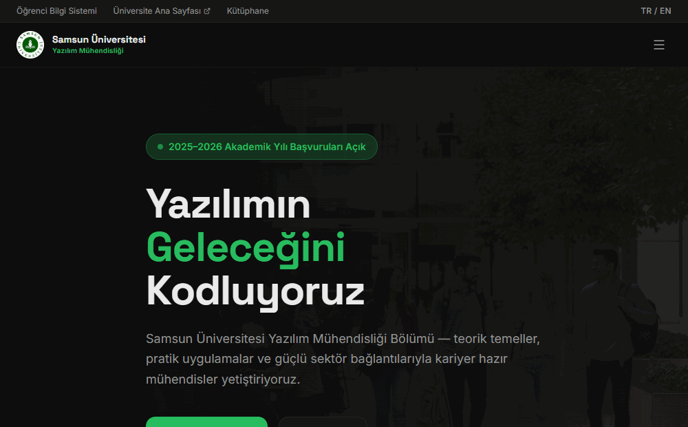

<div align="center">


# Samsun University · Software Engineering


<p>
  
  
  
  
</p>

<a href="#-english"><b>🇬🇧 English</b></a> · <a href="#-türkçe"><b>🇹🇷 Türkçe</b></a>

</div>

<br>

<table align="center">
  <tr>
    <td align="center" width="25%"><br><b>Home</b><br><sub>hero & research</sub></td>
    <td align="center" width="25%"><br><b>Faculty</b><br><sub>staff profiles</sub></td>
    <td align="center" width="25%"><br><b>Research</b><br><sub>labs & projects</sub></td>
    <td align="center" width="25%"><br><b>News</b><br><sub>& announcements</sub></td>
  </tr>
</table>

##  Demo

<div align="center">
  <br><sub>Home page → faculty members → research</sub>
</div>

---

## 🇬🇧 English

> **Course:** Graphic Design · Course project

###  About the Project
A modern redesign of the **Samsun University Software Engineering department** website, made as the Graphic Design course project. The site presents the department, its academic staff, research and student life with a clean, responsive layout.

###  Pages
* 🏠 **Home** — hero section, research areas and a call to join the department
* ℹ️ **About** and 👩‍🏫 **Faculty Members** (with staff photos)
* 📚 **Courses**, **Programs** and **Faculties**
* 🔬 **Research** and **Labs**
* 📰 **News** and 📢 **Announcements**
* 🎓 **Admission**, **Internship**, **Career** and **Alumni**
* 🎉 **Student Life**, **Library**, **International** and ✉️ **Contact**

###  Tech Stack
React 19 · TypeScript · Vite · Wouter (routing) · TanStack Query · Tailwind CSS · Radix UI (shadcn/ui)

###  Running
```bash
npm install
npm run dev
```

---

## 🇹🇷 Türkçe

> **Ders:** Grafik Tasarım · Dönem projesi

###  Proje Hakkında
Grafik Tasarım dersi proje ödevi olarak hazırlanmış, **Samsun Üniversitesi Yazılım Mühendisliği bölümü** web sitesinin modern bir yeniden tasarımıdır. Site; bölümü, akademik kadroyu, araştırmaları ve öğrenci yaşamını sade ve duyarlı (responsive) bir düzenle sunar.

###  Sayfalar
* 🏠 **Ana Sayfa** — giriş bölümü, araştırma alanları ve bölüme katılım çağrısı
* ℹ️ **Hakkımızda** ve 👩‍🏫 **Akademik Kadro** (fotoğraflı)
* 📚 **Dersler**, **Programlar** ve **Fakülteler**
* 🔬 **Araştırma** ve **Laboratuvarlar**
* 📰 **Haberler** ve 📢 **Duyurular**
* 🎓 **Aday Öğrenci**, **Staj**, **Kariyer** ve **Mezunlar**
* 🎉 **Öğrenci Yaşamı**, **Kütüphane**, **Uluslararası** ve ✉️ **İletişim**

###  Teknoloji Yığını
React 19 · TypeScript · Vite · Wouter (yönlendirme) · TanStack Query · Tailwind CSS · Radix UI (shadcn/ui)

###  Çalıştırma
```bash
npm install
npm run dev
```


<br>

<div align="center">
  
  <sub>Made by <a href="https://github.com/huseyinbaranisik">Hüseyin Baran Işık</a> · Animated emojis: <a href="https://github.com/Tarikul-Islam-Anik/Animated-Fluent-Emojis">Animated Fluent Emojis</a></sub>
</div>
